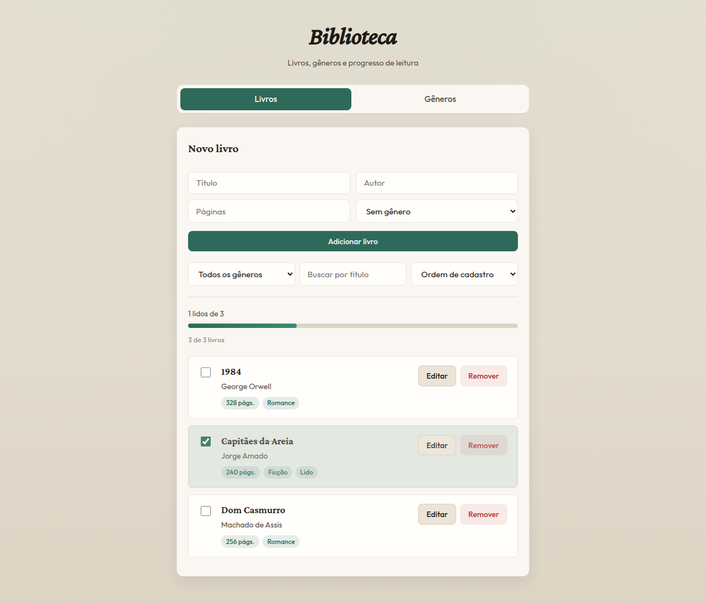
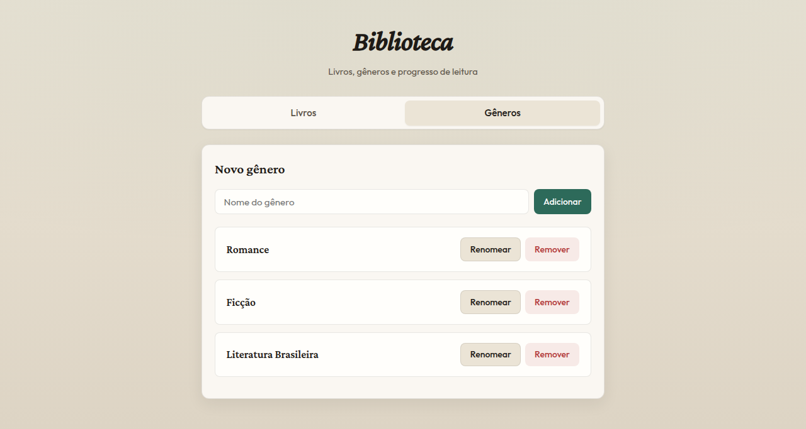
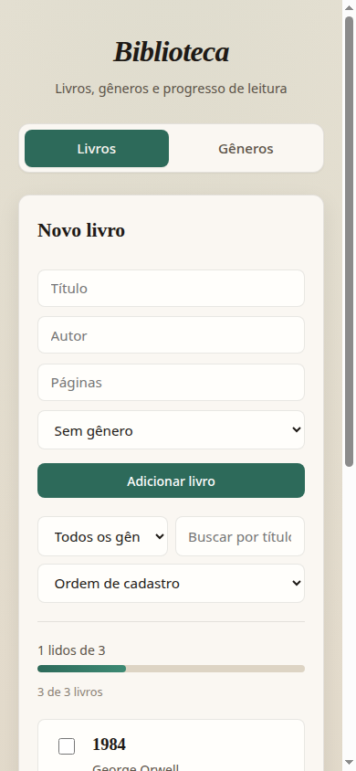

<div align="center">

# Biblioteca

**Organize livros, gêneros e o que você já leu.**  
Frontend React consumindo a API de livros e gêneros da disciplina de **Paradigmas de Programação II**.

[](https://react.dev/)
[](https://www.typescriptlang.org/)
[](https://vitejs.dev/)
[](https://expressjs.com/)
[](https://www.postgresql.org/)
[](LICENSE)

[Sobre](#sobre-o-projeto) ·
[Telas](#telas-do-projeto) ·
[Como executar](#como-executar) ·
[Documentação](#documentação) ·
[Licença](#licença)

</div>

## Sobre o projeto

Trabalho da lista **“React consumindo uma API — Biblioteca”**: mesma linha didática das aulas com tarefas e categorias, agora com **Livro** (`Book`) e **Gênero** (`Genre`) em relação **1:N** (um gênero pode ter vários livros; ao apagar o gênero, `genreId` dos livros vira `NULL`).

O frontend concentra em `frontend-pp2/src/biblioteca/`:

- `fetch` e estados de carregamento, erro e lista vazia
- Formulário controlado e mensagens `{ "message": "..." }` do backend
- CRUD com atualização imutável do state (`[...atual, novo]`, `map`, `filter`)
- Desafios extras: filtro por gênero, busca, barra de progresso, ordenação, edição de páginas/gênero e confirmação ao remover

A API segue **routes → controllers → services → repositories**, na porta **3001** (a de tarefas, se existir, usa **3000**).

### Funcionalidades

| Área | O que está implementado |
| --- | --- |
| **Livros** | Listar, criar, marcar como lido, editar (título, autor, páginas, gênero), remover |
| **Gêneros** | Listar, criar, renomear e remover |
| **UI** | Abas Livros / Gêneros, feedback de erro da API, progresso “X lidos de Y” |
| **Filtros** | Por gênero, busca por título e ordenação sem novo fetch |
| **API** | Validação de título, autor e páginas; erros 400/404; DELETE 204 sem corpo |

## Telas do projeto

### Aba Livros

Formulário de cadastro, filtros, barra de progresso e lista com ações por item.



### Aba Gêneros

Cadastro e manutenção dos gêneros usados no select de livros.



<details>
<summary>Ver versão mobile</summary>



</details>

Mais detalhes sobre as capturas: [docs/capturas/README.md](docs/capturas/README.md).

## Tecnologias

| Camada | Ferramentas |
| --- | --- |
| **Interface** | React 19, TypeScript, Vite 7 |
| **API** | Node.js, Express 5, TypeScript, `tsx` |
| **Persistência** | Prisma 7, PostgreSQL |
| **Qualidade** | TypeScript strict no frontend e no backend |

## Como executar

### Pré-requisitos

- Node.js 20+ (testado com 24)
- PostgreSQL com um banco vazio chamado `biblioteca`

### Backend (`backend-biblioteca-alunos`)

```bash
cd backend-biblioteca-alunos
cp .env.example .env
# Ajuste DATABASE_URL no .env

npm install
npx prisma generate
npx prisma migrate dev --name init
npm run dev
```

| Verificação | URL |
| --- | --- |
| Health | http://localhost:3001 |
| Lista inicial | http://localhost:3001/books → `[]` |

### Frontend (`frontend-pp2`)

Em outro terminal:

```bash
cd frontend-pp2
npm install
npm run dev
```

| Serviço | URL típica |
| --- | --- |
| Interface | http://localhost:5173 |

O frontend chama `http://localhost:3001` (constante `BASE` em `src/biblioteca/api.ts`). As duas aplicações podem rodar ao mesmo tempo.

### Teste rápido da API (exercício 1)

```bash
cd frontend-pp2
node exercicio1.mjs
```

## Estrutura do repositório

```text
backend-biblioteca-alunos/   API Express + Prisma (porta 3001)
frontend-pp2/
  src/biblioteca/            Tipos, api.ts, telas e CRUD
  RESPOSTAS.md               Tabela do ex. 1 e perguntas de revisão
  exercicio1.mjs             Script de exploração da API
docs/
  capturas/                  Screenshots do README
lista-exercicios-biblioteca.docx
frontend-api-tasks-slides-v2.pptx
```

## Documentação

- [Enunciado da lista](lista-exercicios-biblioteca.docx) (Word)
- [README do backend](backend-biblioteca-alunos/README.md) — rotas e regras da API
- [Respostas e revisão](frontend-pp2/RESPOSTAS.md)
- [Galeria de capturas](docs/capturas/README.md)

Repositório: [github.com/igordmouraa/atividade_pp2](https://github.com/igordmouraa/atividade_pp2)

## Licença

Este trabalho acadêmico está licenciado sob a [licença MIT](LICENSE).
